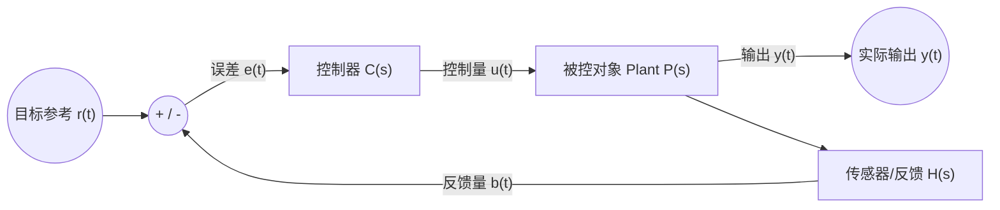

+++
title = '01 | 拉氏变换与传递函数'
date = 2026-11-25T14:01:00+08:00
draft = false
tags = ['自动控制', '学习笔记']
+++

> **本章核心目标**：不仅会套公式，更要看穿 **$s$ 域的物理含义**、**零极点如何决定系统脾气**，以及**控制框图与 Simulink 模型的一一对应关系**。

---

## 1. 拉氏变换：为什么要发明它？

### 1.1 核心动机：把微积分降维成加减乘除

真实物理系统（弹簧阻尼、电机、机械臂连杆）的本质都是**微分方程**。在时域里直接求解高阶微分方程、分析串联/反馈系统非常痛苦（涉及卷积积分）。

拉氏变换把时间函数 $f(t)$ 映射到复频域 $F(s)$：

$$F(s) = \mathcal{L}[f(t)] = \int_{0^-}^{\infty} f(t) e^{-st} \, dt, \quad s = \sigma + j\omega$$

它带来了两个决定性的工程便利：
1. **微分变乘 $s$，积分变除 $s$**：微分方程直接变成关于 $s$ 的多项式代数方程。
2. **卷积变相乘**：两个子系统串联，时域要算卷积，在 $s$ 域直接把传递函数相乘 $G_1(s)G_2(s)$。

### 1.2 复变量 $s = \sigma + j\omega$ 的物理直觉（极重要）

不要把 $s$ 当成抽象字母，把 $e^{st} = e^{\sigma t} e^{j\omega t}$ 拆开看，它代表了自然界最基本的信号形态：
- **实部 $\sigma$**：控制**幅值包络的衰减或发散**。$\sigma < 0$ 时 $e^{\sigma t}$ 指数衰减（稳定）；$\sigma > 0$ 时指数爆炸（发散）。
- **虚部 $\omega$**：控制**振荡的角频率**（$\text{rad/s}$）。$\omega = 0$ 时单调变化不振荡；$|\omega|$ 越大，震得越快。

> **为什么傅里叶变换不够用？** 傅里叶变换只在虚轴 $s = j\omega$ 上看问题（只看稳态正弦振荡），对于发散信号（如阶跃、斜坡、不稳定系统）积分不收敛。拉氏变换多乘了一个衰减因子 $e^{-\sigma t}$，既让更多信号收敛，又能同时刻画**暂态衰减速度（$\sigma$）**和**振荡频率（$\omega$）**。

---

## 2. 常见拉氏变换与核心性质速查

### 2.1 常用变换表（配推导锚点）

| 时域信号 $f(t)\ (t \ge 0)$ | 拉氏变换 $F(s)$ | 推导/记忆锚点 | 工程用途 |
| --- | --- | --- | --- |
| 单位冲激 $\delta(t)$ | $1$ | 筛选性质 $\int \delta(t)e^{-st}dt = e^0 = 1$ | 测系统固有特性（传函即冲激响应的拉氏变换） |
| 单位阶跃 $1(t)$ | $\dfrac{1}{s}$ | $\int_0^\infty e^{-st}dt = \left[-\frac{1}{s}e^{-st}\right]_0^\infty$ | 最常用测试输入（如给连杆发一个目标角度指令） |
| 单位斜坡 $t$ | $\dfrac{1}{s^2}$ | 阶跃的积分 → 除以 $s$ | 测试匀速跟踪能力 |
| 单位加速度 $\frac{1}{2}t^2$ | $\dfrac{1}{s^3}$ | 斜坡的积分 → 再除以 $s$ | 测试匀加速跟踪能力 |
| 指数衰减 $e^{-at}$ | $\dfrac{1}{s+a}$ | 频移性质：阶跃的 $s$ 换成 $s+a$ | 一阶系统的基本模态（极点在 $s=-a$） |
| 正弦 $\sin(\omega t)$ | $\dfrac{\omega}{s^2+\omega^2}$ | 欧拉公式 $\frac{e^{j\omega t}-e^{-j\omega t}}{2j}$ 合并 | 频率响应、无阻尼振荡 |
| 余弦 $\cos(\omega t)$ | $\dfrac{s}{s^2+\omega^2}$ | 欧拉公式 $\frac{e^{j\omega t}+e^{-j\omega t}}{2}$ 合并 | 无阻尼自由响应 |
| 衰减正弦 $e^{-at}\sin(\omega t)$ | $\dfrac{\omega}{(s+a)^2+\omega^2}$ | 对 $\sin(\omega t)$ 做频移 $s \to s+a$ | 欠阻尼二阶系统的核心响应项 |

### 2.2 最有用的 4 条运算性质

| 性质 | 公式 | 工程意义 |
| --- | --- | --- |
| **微分定理** | $\mathcal{L}[\dot{f}(t)] = sF(s) - f(0^-)$ | 零初始条件下，求导就是乘 $s$ |
| **积分定理** | $\mathcal{L}\left[\int_0^t f(\tau)d\tau\right] = \dfrac{1}{s}F(s)$ | 积分器在框图和 Simulink 里就是 `1/s` |
| **终值定理** | $\lim_{t\to\infty} f(t) = \lim_{s\to 0} sF(s)$ | **求稳态误差的核心工具**（前提：$sF(s)$ 的所有极点都在左半平面！） |
| **初值定理** | $\lim_{t\to 0^+} f(t) = \lim_{s\to\infty} sF(s)$ | 判断系统在 $t=0^+$ 瞬间有没有跳变 |

---

## 3. 传递函数：系统的「黑盒身份证」

### 3.1 定义与隐含前提

在**零初始条件**下，线性定常系统（LTI）输出的拉氏变换与输入的拉氏变换之比：

$$G(s) = \frac{Y(s)}{U(s)} = \frac{b_m s^m + \dots + b_1 s + b_0}{a_n s^n + \dots + a_1 s + a_0} = K^* \frac{\prod_{i=1}^{m}(s - z_i)}{\prod_{j=1}^{n}(s - p_j)}$$

> **应试视频常忽略的 3 个前提与真相**：
> 1. **必须线性定常（LTI）**：像二连杆这种含 $\sin\theta, \cos\theta, \dot{\theta}^2$ 的非线性系统，**不能直接写全局传递函数**，必须先在某个工作点线性化，或者直接进现代控制/非线性仿真。
> 2. **物理可实现系统必满足 $n \ge m$**（分母阶次 $\ge$ 分子阶次）：否则包含纯微分环节，高频噪声会被无限放大。
> 3. **传递函数只反映「外部输入到输出」的关系**：如果系统内部有不可控或不可观的模态（零极点对消），传递函数会把它「藏起来」，这是后面学现代控制（状态空间）的重要原因。

### 3.2 极点（Poles）与零点（Zeros）的物理本质

| 概念 | 数学定义 | 决定什么？ | 一句话直觉 |
| --- | --- | --- | --- |
| **极点 $p_j$** | 分母多项式 $= 0$ 的根 | 系统的**固有运动模态** $e^{p_j t}$ 与**稳定性** | **决定生死与脾气**：只要有一个极点跑到右半平面，系统就发散爆炸 |
| **零点 $z_i$** | 分子多项式 $= 0$ 的根 | 各个模态的**权重（幅值大小）**，不改变模态本身 | **决定发力姿势**：左半平面零点加快响应但也加大超调；右半平面零点（非最小相位）会导致**反向先走再拉回（下冲）** |

---

## 4. 系统框图、开环传函与闭环传函

### 4.1 经典负反馈控制骨架（看懂所有控制图的基础）

无论 Simulink 模型画得多复杂，主干都是下面这 5 段结构：



设前向通道 $G(s) = C(s)P(s)$，反馈通道为 $H(s)$（单位反馈时 $H(s)=1$）：

| 名称 | 表达式 | 它到底在干嘛？（工程视角） |
| --- | --- | --- |
| **开环传递函数**（环路增益） | $L(s) = G(s)H(s)$ | 信号绕闭环跑一圈的总放大倍数；**用来分析稳定裕度（Bode/根轨迹）和稳态误差** |
| **闭环传递函数**（互补敏感度 $T$） | $\Phi(s) = \dfrac{G(s)}{1 + G(s)H(s)}$ | 整个闭环系统对外表现出的真实动态特性；**分母 $1+G(s)H(s)=0$ 是闭环特征方程** |
| **误差传递函数**（敏感度 $S$，单位反馈下） | $\Phi_e(s) = \dfrac{E(s)}{R(s)} = \dfrac{1}{1 + G(s)}$ | **应试少讲、工程核心**：它同时决定了跟踪误差大小和抗外部扰动能力！ |

> **工程金律**：在单位反馈下，$T(s) + S(s) = 1$。想让跟踪误差小、抗扰动强，就要让 $S(s)$ 尽量小（即在工作频段内让开环增益 $|L(j\omega)| \gg 1$）；但高频段有传感器噪声，噪声会经由 $T(s)$ 传到输出，因此高频段又要让 $|L(j\omega)| \ll 1$。**所有控制器设计的本质，就是在低频高增益与高频低增益之间做权衡（Loop Shaping）。**

### 4.2 框图化简的实操原则

不需要死记复杂的梅森公式和十几种等效移动套路，记住三条基本规则就够用，复杂的直接交给 Simulink 或 MATLAB `connect`：
- **串联**：相乘 $G_1 G_2$
- **并联**：相加 $G_1 \pm G_2$
- **负反馈**：$\dfrac{\text{前向}}{1 + \text{前向}\times\text{反馈}}$（正反馈分母改为减号）

---

## 5. MATLAB / Simulink 对应落地

### 5.1 用 MATLAB 验证传函与闭环（无需手算化简）

```matlab
s = tf('s');

% 假设一个简化的单连杆电机对象：J*theta'' + b*theta' = u
J = 0.05;  % 转动惯量 (kg*m^2)
b = 0.1;   % 粘性阻尼系数
P = 1 / (J*s^2 + b*s);

% 简单比例控制器 C(s) = Kp
Kp = 2;
C = Kp;

% 开环与闭环传函
L = C * P;              % 开环传函
T = feedback(L, 1);     % 单位负反馈闭环传函
S = feedback(1, L);     % 误差/敏感度传函

% 直接查看闭环零极点与阻尼比
pole(T)
damp(T)
```

### 5.2 与 Simulink 模块的映射

| 理论概念 | Simulink 模块 | 说明 |
| --- | --- | --- |
| 积分 $\frac{1}{s}$ | `Integrator` | 搭物理方程最常用，可设置初始状态（比传函更灵活） |
| 传递函数 $G(s)$ | `Transfer Fcn` | 直接填分子分母系数向量，适合线性子系统 |
| 比较点 $\pm$ | `Sum` | 设置符号为 `+-` 即构成负反馈误差计算 |
| 阶跃输入 $1(t)$ | `Step` | 测试系统响应最常用激励源 |
| 输出观测 | `Scope` | 实时看时域波形 |
