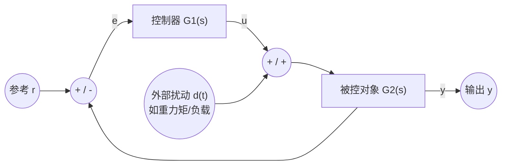

+++
title = '03 | 稳态误差与抗扰动能力'
date = 2026-11-25T14:01:02+08:00
draft = false
tags = ['自动控制', '学习笔记']
+++

> **本章核心目标**：不仅会算「跟踪参考输入的稳态误差」，更要吃透工程中最关键的 **「外部扰动（如机械臂重力矩）稳态误差」**，彻底理解**积分环节（I）为什么要放在控制器里**。

---

## 1. 稳态误差的定义与致命前提

稳态误差是指系统进入稳态后，实际输出与期望目标之间残留的偏差：

$$e_{ss} = \lim_{t \to \infty} e(t) = \lim_{s \to 0} s E(s)$$

> **最容易踩的坑（终值定理前提）**：使用终值定理前，**必须先确认闭环系统是稳定的**（即 $sE(s)$ 的所有极点都在左半平面）。如果系统本身已经发散，强行套 $\lim_{s\to 0} sE(s)$ 会算出一个毫无意义的有限假数字！

---

## 2. 跟踪参考输入的稳态误差（单位反馈下）

对于单位负反馈系统，开环传递函数写成「时间常数标准型（尾 1 型）」：

$$G(s) = \frac{K \prod (\tau_i s + 1)}{s^v \prod (T_j s + 1)}$$

- **$v$（系统型别）**：开环传函在原点 $s=0$ 处的极点个数，也就是**开环串联的纯积分器 $\frac{1}{s}$ 的个数**（0 型、I 型、II 型）。
- **$K$（开环增益）**：各括号常数项化为 1 后的系数。

### 2.1 三大典型输入与静态误差系数速查表

| 输入信号 $r(t)$ | $R(s)$ | 静态误差系数 | 0 型 ($v=0$) | I 型 ($v=1$) | II 型 ($v=2$) |
| --- | --- | --- | --- | --- | --- |
| **阶跃 $A\cdot 1(t)$**（定角度定位） | $\dfrac{A}{s}$ | $K_p = \lim_{s\to 0} G(s)$ | $\dfrac{A}{1+K_p}$ | **$0$** | **$0$** |
| **斜坡 $A\cdot t$**（匀速跟踪） | $\dfrac{A}{s^2}$ | $K_v = \lim_{s\to 0} sG(s)$ | $\infty$ | $\dfrac{A}{K_v}$ | **$0$** |
| **加速度 $\frac{1}{2}A t^2$**（匀加速跟踪） | $\dfrac{A}{s^3}$ | $K_a = \lim_{s\to 0} s^2 G(s)$ | $\infty$ | $\infty$ | $\dfrac{A}{K_a}$ |

### 2.2 一句话看穿本质（内模原理的朴素版）

**为什么开环有一个积分器（I 型），就能无静差跟踪阶跃？**
- 积分器的物理行为是：**只要输入（误差 $e$）不等于 0，它的输出就会一直累积增大**，直到把被控对象推到误差 $e = 0$ 为止，此时积分器的输出刚好维持在某个常值，撑住整个系统！
- 如果没有积分器（0 型），比如纯比例控制 $u = K_p e$，一旦误差 $e = 0$，控制输出 $u$ 就变成了 $0$，系统根本维持不住目标位置，所以必然留有静差。

---

## 3. 应试视频常漏掉的真本事：外部扰动引起的稳态误差

在真实控制（尤其是**单连杆 / 二连杆机械臂**）中，跟踪阶跃只是前半场，真正让你头疼的是**外部扰动 $d(t)$**——比如**重力矩 $mgl\sin\theta$、未建模摩擦力、手爪抓起一个重物**。

看下面这个带外部扰动（力矩扰动）的闭环框图：



令参考输入 $r(t) = 0$，仅看扰动 $d(t)$ 引起的误差（$E_d(s) = -Y_d(s)$）：

$$\frac{E_d(s)}{D(s)} = \frac{-G_2(s)}{1 + G_1(s)G_2(s)}$$

当 $d(t)$ 为**常值扰动**（比如把连杆举在水平位置时的恒定重力矩 $D(s) = D_0 / s$）：

$$e_{ss,d} = \lim_{s\to 0} s \cdot \frac{-G_2(s)}{1 + G_1(s)G_2(s)} \cdot \frac{D_0}{s} = \lim_{s\to 0} \frac{-D_0}{\dfrac{1}{G_2(s)} + G_1(s)}$$

### 得出一条极其重要的工程铁律：
- 即使被控对象 $G_2(s)$ 自己带积分器（比如单连杆 $G_2(s) = \frac{1}{Js^2+bs}$ 已经是 I 型系统！），**单靠 $G_2(s)$ 的积分器，无法消除作用在它前面的常值力矩扰动 $D_0$**！因为 $\lim_{s\to 0} \frac{1}{G_2(s)} = 0$，分母只剩下 $G_1(0) = K_p$，结果仍会有静差：
  $$e_{ss,d} = -\frac{D_0}{K_p}$$
  （物理直觉：单连杆用 PD 控制举在水平位置，重力把它往下拽，必须歪掉一个小角度 $e$，才能让弹簧项 $K_p e$ 产生刚好抵消重力的力矩！）
- **怎么彻底消除常值扰动静差？** 必须让扰动作用点**之前**的控制器 $G_1(s)$ 带有积分器（即加上 **I 环节**，$G_1(s) = K_p + \frac{K_i}{s} + K_d s$），使得 $\lim_{s\to 0} G_1(s) = \infty$，从而 $e_{ss,d} = 0$！

> **两条工程应对方案**（后面在二连杆里全都会用到）：
> 1. **反馈侧加积分（PID）**：不需要知道重力多大，靠积分慢慢蓄力顶住重力（通用，但会拖慢响应、增加超调）。
> 2. **前馈重力补偿（Feedforward）**：既然知道重力矩公式 $mgl\sin\theta$，直接提前算出来加到控制量 $u$ 里抵消掉，根本不等误差出现！

---

## 4. 「稳、准、快」的天然矛盾

想要稳态误差小（**准**），直观做法就两种，但都有代价：

| 提准手段 | 效果 | 付出的代价 |
| --- | --- | --- |
| **增大开环增益 $K$** | 减小静差、加快响应 | 超调增大、相位裕度变小，**太大直接不稳定**；同时放大传感器高频噪声 |
| **增加开环积分器个数 $v$** | 彻底消除高阶输入或常值扰动静差 | 每个积分器带来 **$-90^\circ$ 相位滞后**，极易引起振荡甚至失稳（工程上极少用超过 II 型） |

> 这就是为什么不能只靠「猛加 $K$ 或猛加积分」解决问题，必须进入下一阶段：**频域分析（看清稳定裕度还剩多少）+ PID/校正设计**。

---

## 5. MATLAB 实操：亲眼看到 PD 的重力静差 vs PID 消除静差

```matlab
s = tf('s');
J = 0.05; b = 0.1;
G2 = 1 / (J*s^2 + b*s);    % 单连杆对象（本身含1个积分器）

% 控制器对比：PD vs PID
Kp = 5; Kd = 0.5; Ki = 8;
C_pd  = Kp + Kd*s;
C_pid = Kp + Ki/s + Kd*s;

% 扰动到输出的传函：Y(s)/D(s) = G2 / (1 + C*G2)
% 给一个恒定重力矩扰动 D0 = -1 N*m（负号表示向下拽）
T_dist_pd  = feedback(G2, C_pd);
T_dist_pid = feedback(G2, C_pid);

t = 0:0.01:5;
y_pd  = -1 * step(T_dist_pd, t);
y_pid = -1 * step(T_dist_pid, t);

figure;
plot(t, y_pd, 'r--', 'LineWidth', 1.5); hold on;
plot(t, y_pid, 'b-', 'LineWidth', 1.5);
yline(0, 'k:'); grid on;
legend('PD 控制（留有重力静差 -1/Kp = -0.2 rad）', 'PID 控制（积分消除静差 → 0）');
xlabel('时间 (s)'); ylabel('角度偏差 (rad)');
title('单连杆承受恒定重力矩扰动时的稳态误差对比');
```
