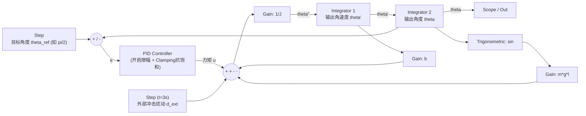

+++
title = '05 | PID控制与单连杆实战'
date = 2026-11-25T14:01:04+08:00
draft = false
tags = ['自动控制', '学习笔记']
+++

> **本章核心目标**：把前面 4 章的「传函、极点、稳态误差、频域裕度」全部融合到工业界 90% 场景都在用的 **PID 控制器** 中，并落地到你的第一个 Simulink 实战项目——**带重力的单连杆控制系统**。

---

## 1. PID 三项的「物理 + 频域」双视角本质

$$u(t) = K_p e(t) + K_i \int_0^t e(\tau)\,d\tau + K_d \frac{de(t)}{dt} \quad \Longleftrightarrow \quad C(s) = K_p + \frac{K_i}{s} + K_d s$$

不要只背口诀，同时用**物理类比（弹簧-阻尼器）**和**频域视角（Bode 图）**记住它们：

| 环节 | 物理本质（机械类比） | 对 Bode 图干了什么？ | 调大后的正面效果 | 调太大的副作用 |
| --- | --- | --- | --- | --- |
| **P（比例）** | **虚拟弹簧**：偏得越远拉得越狠 | 把整条幅频曲线**上下平移** | 加快响应、减小稳态误差 | 超调变大、相位裕度下降、剧烈震荡 |
| **I（积分）** | **记忆蓄力器**：只要还有静差就持续加力 | **大幅抬高低频增益**，但带来 $-90^\circ$ 相位滞后 | **彻底消除常值稳态误差**（如重力静差） | 相位裕度变差、响应变慢、超调增大、易饱和 |
| **D（微分）** | **虚拟阻尼/刹车**：看趋势提前踩刹车 | **在中高频提供正相位（相位超前）**，但放大高频增益 | **大幅抑制超调、救活相位裕度** | **严重放大高频传感器噪声**，导致电机高频抖动发烫 |

---

## 2. 工程级 PID 必须知道的 3 个实战改造（教科书很少细讲）

在 Simulink 里直接拖一个理想 `Kp + Ki/s + Kd*s` 去控真实对象，往往会踩 3 个经典大坑：

### 2.1 坑一：纯微分放大噪声 → 必须用「不完全微分（带低通滤波）」
真实角度编码器都有量化误差和高频噪声，直接求导 $\frac{de}{dt}$ 会把微小的毛刺放大成巨大的力矩尖峰。
- **工程做法**：把 $K_d s$ 改成一阶滤波微分：
  $$D(s) = \frac{K_d N s}{s + N} \quad (\text{或 } \frac{K_d s}{\tau_f s + 1})$$
- 其中 $N$ 是滤波系数（在 Simulink 的 `PID Controller` 模块里就是参数 `N`），一般取闭环带宽的 $5 \sim 20$ 倍：中频段提供阻尼，高频段截断噪声。

### 2.2 坑二：阶跃瞬间「微分冲击（Derivative Kick）」→ 改用「微分先行」
当目标参考 $r(t)$ 突然从 $0^\circ$ 跳变到 $90^\circ$ 时，误差 $e = r - y$ 发生阶跃，对 $e$ 求导会产生一个理论无穷大的冲击脉冲，把电机瞬间打满。
- **工程做法**：**只对反馈量 $-y$ 求导**（对电机/连杆来说，直接用角速度 $-\dot{\theta}$ 乘 $K_d$），即 $u_d = -K_d \dot{\theta}$。这样既保留全部阻尼效果，又彻底消除目标跳变带来的微分冲击（同时消除了闭环零点带来的额外超调！）。

### 2.3 坑三：执行器力矩限幅导致「积分饱和（Integral Windup）」→ 必须加抗饱和
实际电机有最大力矩上限（比如 $\pm 5\text{ N}\cdot\text{m}$）。如果目标很远，电机已经全力输出了，误差还是很大，**积分器不知道电机已经到顶，仍在疯狂累加**。等连杆冲过目标后，积分器里攒了一大堆「历史债务」，导致连杆大幅超调、迟迟拉不回来。
- **工程做法（Simulink 一键开启）**：在 `PID Controller` 模块 → `Output Saturation` 勾选限幅 → `Anti-windup method` 选 **`clamping`（遇限削弱/钳位）** 或 **`back-calculation`（反向计算）**。

---

## 3. 手动调参通用顺序（不玄学，4 步搞定）

面对一个新系统（比如单连杆），按 **「P → D → I → 微调与抗扰测试」** 的顺序调：

1. **先关掉 I 和 D（$K_i=0, K_d=0$），从小到大加 $K_p$**：让连杆动起来，直到响应速度接近预期且开始出现轻微振荡。
2. **加 $K_d$ 踩刹车**：逐步增大 $K_d$，把超调压下去（压到 $5\%$ 以内或无超调），此时可以再适当补一点 $K_p$ 提速。
3. **最后加 $K_i$ 消静差**：如果存在重力引起的稳态偏差，从小到大缓慢加 $K_i$，刚好能把静差拉回 0 且不明显破坏超调即可。
4. **加扰动和限幅做压力测试**：在仿真中途（如 $t=3\text{s}$）突然叠加一个外部力矩冲击，同时把电机力矩限幅加上，确认不发散、不饱和振荡。

---

## 4. Simulink 实战：搭建你的第一个「带重力单连杆」闭环模型

### 4.1 物理方程（非线性！）

单连杆绕支点转动，设转动惯量 $J$、粘性阻尼 $b$、质量 $m$、质心距转轴距离 $l$、重力加速度 $g$（定义 $\theta = 0$ 为竖直向下，$\theta = \pi/2$ 为水平）：

$$J\ddot{\theta} + b\dot{\theta} + mgl\sin\theta = u + d_{\text{ext}}$$

改写成**最高阶导数在左边**（Simulink 搭积分器链的黄金写法！）：

$$\ddot{\theta} = \frac{1}{J}\Big(u + d_{\text{ext}} - b\dot{\theta} - mgl\sin\theta\Big)$$

### 4.2 Simulink 搭积木路线图



### 4.3 配套 MATLAB 初始化脚本（运行后再点 Simulink Run）

把物理参数和 PID 参数放在 MATLAB 工作区里，Simulink 模块里直接填变量名（`J`, `b`, `m*g*l`, `Kp`, `Ki`, `Kd`），调参时只改脚本再运行，极其高效：

```matlab
%% 单连杆物理参数
J = 0.05;          % 转动惯量 (kg*m^2)
b = 0.1;           % 阻尼系数 (N*m*s/rad)
m = 1.0;           % 连杆质量 (kg)
l = 0.25;          % 质心到转轴距离 (m)
g = 9.81;          % 重力加速度 (m/s^2)
tau_max = 6.0;     % 电机最大输出力矩限幅 (N*m)

%% 目标设定（举到水平位置 90° = pi/2）
theta_ref = pi/2;  % 此时重力矩最大 = m*g*l = 2.4525 N*m

%% PID 初始参数（先试 PD: Ki=0 看重力静差，再把 Ki 改为 15 看静差消失）
Kp = 20;
Ki = 15;           % 对比实验：先设 0，再设 15
Kd = 3.0;
N  = 50;           % 微分滤波系数

%% 进阶：如果加上前馈重力补偿 u_ff = m*g*l*sin(theta)
% 你会发现即使 Ki = 0，连杆也能稳稳停在任意角度，且响应比纯 PID 快得多！
```

> **动手必做的 3 个小实验**（10 分钟建立终身直觉）：
> 1. `Ki = 0` 跑一次：亲眼看到连杆被重力拉低了约 $0.12\text{ rad}$（$\approx 7^\circ$），停不平。
> 2. `Ki = 15` 跑一次：看到积分慢慢把连杆顶回 $90^\circ$，且观察此时控制器输出 $u$ 稳定在 $2.45\text{ N}\cdot\text{m}$（刚好等于重力矩 $mgl$）。
> 3. 把 `tau_max` 设紧（如 `3.0`），开关 `Anti-windup` 对比一次：亲眼看到积分饱和如何制造巨大超调。
